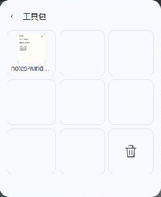

# Mewu 工具包

独立 Mewu API 插件，使用 `@mewu/sdk`，无需 Node、Electron 或模型密钥。

安装后在截图空间显示工具包。八个收藏格，右下角为垃圾桶。对象拖入收藏、拖出创建副本，叠放形成文件夹；收藏跨会话和 Agent 共用。停用或卸载插件会移除入口，保留收藏，重新安装同一插件后可继续使用。

图片、视频、HTML/SVG、文本、黑板及可拖动的绘制对象均通过宿主的受控对象库保存。不会把本机路径、会话消息或 API 密钥交给插件。HTML 保存源代码，不保存临时 JavaScript 堆。

需要 MewuAI 1.0.4 或更新版本，提供 `objects.library`、`ui.surfaces` 和 `objects.preview`。插件自己提供 `space-overlay` HTML 文档；宿主不内置工具包的布局或操作。旧版会明确提示更新。

图片收藏显示含标注的真实缩略图，拖动时预览跟随鼠标；文件夹显示其中图片的缩略图。其他对象仍可收藏与取出，暂不生成视频或交互 HTML 的缩略图。Esc 收起工具包，入口保留在截图空间原有的左下角工具条中。

包只含 `mewu-plugin.json`、`index.mjs` 和 `view.mjs`。许可证 MPL-2.0。

## 实际界面



MewuAI 1.0.4 候选版本与本插件 0.1.2 的实拍；只裁去了插件外的桌面。已在 Windows 中验证拖入图片、真实缩略图、拖出创建副本和 Esc 收起。三端完整验收和安装包发布仍在进行。

## 安装

需要 MewuAI 1.0.4 或更新版本。在 Mewu 的插件市场安装，或从本仓库 Releases 下载 ZIP，在设置 → 插件中添加。插件无需 Node.js、Electron 或模型密钥。

## 开发

源码仅包含清单、运行入口和界面模块。依赖由 Mewu 提供的 `@mewu/sdk` 与受控界面桥，无 npm 安装脚本。

在 [Mewu 源码仓库](https://github.com/abnste/mewu_ai) 中编译插件校验器后，用其发行工具对本项目打包：

```sh
node /path/to/mewu_ai/tools/extension-market/cli.mjs pack . --file view.mjs --out mewu-plugin-object-toolbox-0.1.2.zip --validator /path/to/mewu-plugin-validator
```

插件 ID 保持不变，更新不会另建一份存储。停用和卸载会撤销界面与执行权限，但保留插件自身内容；重装同一插件可以恢复。
